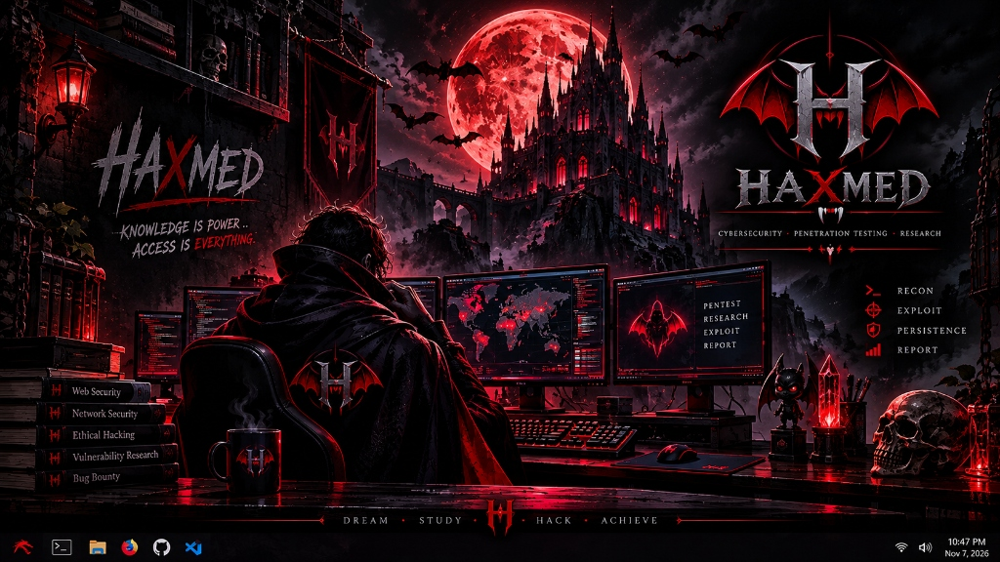

<div align="center">


<br /><br />

<a href="https://0xhaxmed.github.io/Mohamed_Heshame/">
  
</a>

<p align="center">
  <a href="https://0xhaxmed.github.io/Mohamed_Heshame/"></a>
  <a href="https://tryhackme.com/p/MohamedHesham.22"></a>
  <a href="https://www.linkedin.com/in/mohamed-heshame-093232300/"></a>
  <a href="mailto:mohamedhesham1033@gmail.com"></a>
</p>

<p align="center">
  <sub><code>DREAM &bull; STUDY &bull; HACK &bull; ACHIEVE</code></sub>
</p>

</div>

---

## ⸸ Identity // Who Is HAXMED?

<table>
<tr>
<td width="62%" valign="top">

### **Mohamed Hesham (`0xHaxmed`)**
**Offensive Security Practitioner & Web Application Penetration Tester**

I approach systems through the lens of offensive security: dissecting target architecture, identifying overlooked attack surfaces, validating impact through rigorous manual testing, and formulating actionable remediation.

Rather than relying on automated scanning outputs, my methodology prioritizes **manual code and endpoint analysis, business logic dissection, and multi-stage flaw chaining**. I treat security as an exact craft built on persistent lab work, technical documentation, and continuous research across real-world application flaws.

</td>
<td width="38%" valign="top">

### **Core Focus**

- 🩸 **Web Application Pentesting**
- ⚔️ **Offensive Security Operations**
- 🔍 **Vulnerability Research & Assessment**
- 📡 **Reconnaissance & Deep Enumeration**
- 🛡️ **OWASP Top 10 Attack Vectors**
- ⚙️ **Security Automation (Python & Bash)**

</td>
</tr>
</table>

---

## 🩸 The Mission

> ### *"KNOWLEDGE IS POWER. ACCESS IS EVERYTHING."*

Modern web infrastructures fail not because defenders lack tools, but because complexity introduces blind spots. The mission of **HAXMED** is to master how modern applications break at the structural level — hunting logic discrepancies, broken trust assumptions, and subtle authorization gaps before malicious actors exploit them.

Every test conducted, lab solved, and tool engineered serves a single doctrine: **Understand the architecture completely, prove the exploit definitively, and secure the perimeter permanently.**

---

## 💻 Terminal Identity

```bash
┌──(haxmed㉿kali-crypt)-[~/offensive/engagement]
└─$ cat /etc/haxmed/operator_manifest.json
{
  "handle": "HAXMED",
  "real_name": "Mohamed Hesham",
  "role": "Offensive Security Practitioner",
  "specialization": "Web Application Penetration Testing & Vulnerability Assessment",
  "doctrine": "Knowledge is power. Access is everything.",
  "principles": [
    "Manual analysis takes precedence over automated scanners",
    "Identify root causes, not merely symptoms",
    "Flaw chaining converts low-severity findings into critical proof-of-concepts",
    "Every valid exploit must be backed by actionable defense guidance"
  ],
  "operational_scope": "Authorized targets, controlled labs, CTF challenges, and sanctioned research"
}

┌──(haxmed㉿kali-crypt)-[~/offensive/engagement]
└─$ echo $CORE_DIRECTIVE
"DREAM • STUDY • HACK • ACHIEVE"
```

---

## ⚔️ The Arsenal // Technical Capabilities

<table>
<tr>
  <td width="28%"><b>Offensive Security &amp; Testing</b></td>
  <td>
    
    
    
    
  </td>
</tr>
<tr>
  <td><b>Operating Environments</b></td>
  <td>
    
  </td>
</tr>
<tr>
  <td><b>Scripting &amp; Automation</b></td>
  <td>
    
    
  </td>
</tr>
<tr>
  <td><b>Web Protocols &amp; Standards</b></td>
  <td>
    
    
    
    <br />
    
  </td>
</tr>
</table>

---

## 🎯 Training Grounds

<table>
<tr>
<td width="50%" valign="top">

### 🩸 **TryHackMe**

Practical hands-on lab environments for building and stress-testing offensive security techniques, network enumeration, and privilege escalation:

- Simulated enterprise networks & active service enumeration
- Linux privilege escalation vectors and credential harvesting
- Active vulnerability exploitation across vulnerable machines
- Real-world CTF scenario problem solving

<br />

<a href="https://tryhackme.com/p/MohamedHesham.22">
  
</a>

</td>
<td width="50%" valign="top">

### ⚔️ **PortSwigger Web Security Academy**

Rigorous practice on dedicated web vulnerability labs with direct focus on modern application flaw classes:

- **Authentication & Access Control:** BOLA, IDOR, session fixation, JWT weaknesses
- **Server-Side Injection:** Advanced SQLi, command injection, blind SSRF
- **Client-Side Attacks:** Reflected, Stored, and DOM-based Cross-Site Scripting (XSS)
- **Business Logic Flaws:** Workflow bypasses, rate limit manipulation, race conditions

<br />

<a href="https://portswigger.net/web-security">
  
</a>

</td>
</tr>
</table>

---

## 💀 Projects & Research

Structured repositories reflecting hands-on investigations, testing workflows, and custom tooling:

<table>
<tr>
  <th>Repository</th>
  <th>Description</th>
  <th>Tech Stack</th>
</tr>
<tr>
  <td><a href="https://github.com/0xHaxmed/-WEB-PENTEST-LABS-"><b>-WEB-PENTEST-LABS-</b></a></td>
  <td>Curated web penetration testing labs, vulnerability assessments, and manual exploit reproduction covering OWASP Top 10 vectors.</td>
  <td><code>Web Security</code> <code>OWASP</code> <code>Burp Suite</code></td>
</tr>
<tr>
  <td><a href="https://github.com/0xHaxmed/-Penetration-testing-writeups-and-lab-reports"><b>-Penetration-testing-writeups-and-lab-reports</b></a></td>
  <td>Structured pentesting write-ups and detailed lab reports breaking down root causes, step-by-step reproduction, and defensive fixes.</td>
  <td><code>Reports</code> <code>Documentation</code> <code>Root Cause Analysis</code></td>
</tr>
<tr>
  <td><a href="https://github.com/0xHaxmed/Web-Application-Security-Fundamentals-"><b>Web-Application-Security-Fundamentals-</b></a></td>
  <td>In-depth methodology guide covering DevTools inspection, passive reconnaissance, content discovery, and web server analysis.</td>
  <td><code>Methodology</code> <code>Recon</code> <code>Server Auditing</code></td>
</tr>
<tr>
  <td><a href="https://github.com/0xHaxmed/Silent-Scrapers"><b>Silent-Scrapers</b></a></td>
  <td>Custom security reconnaissance and enumeration automation scripts engineered for targeted data collection and asset discovery.</td>
  <td><code>Python</code> <code>Automation</code> <code>OSINT</code></td>
</tr>
<tr>
  <td><a href="https://github.com/0xHaxmed/HAXMED-CryptoLab-"><b>HAXMED-CryptoLab-</b></a></td>
  <td>Cryptographic experiments, cipher analysis, algorithmic decryption exercises, and practical security lab solutions.</td>
  <td><code>Cryptography</code> <code>Ciphers</code> <code>Python</code></td>
</tr>
</table>

---

## 🕸️ The Hunting Process // Technical Workflow

```text
  [01. RECONNAISSANCE]          [02. ENUMERATION]          [03. EXPLOITATION]          [04. REPORTING]
┌───────────────────────┐   ┌───────────────────────┐   ┌───────────────────────┐   ┌───────────────────────┐
│ Passive OSINT         │   │ Endpoint Discovery    │   │ Manual Verification   │   │ Root Cause Analysis   │
│ Tech Stack Fingerprint│──>│ Parameter Fuzzing     │──>│ Vulnerability Chaining│──>│ Actionable Remediation│
│ Attack Surface Mapping│   │ Privilege Boundary Map│   │ PoC Script Generation │   │ Risk Rating & Context │
└───────────────────────┘   └───────────────────────┘   └───────────────────────┘   └───────────────────────┘
```

> *"A vulnerability is only as valuable as the report that explains it. True offensive capability is demonstrated when engineers can reproduce the issue instantly and patch it permanently."*

---


## 🩸 Connect With HAXMED

<div align="center">

<a href="https://0xhaxmed.github.io/Mohamed_Heshame/"></a>
<a href="https://github.com/0xHaxmed"></a>
<a href="https://www.linkedin.com/in/mohamed-heshame-093232300/"></a>
<a href="https://tryhackme.com/p/MohamedHesham.22"></a>
<a href="mailto:mohamedhesham1033@gmail.com"></a>

<br /><br />



<br /><br />

<sub><code>KNOWLEDGE IS POWER. ACCESS IS EVERYTHING.</code></sub><br />
<sub><code>DREAM &bull; STUDY &bull; HACK &bull; ACHIEVE</code></sub>

<br /><br />


</div>
